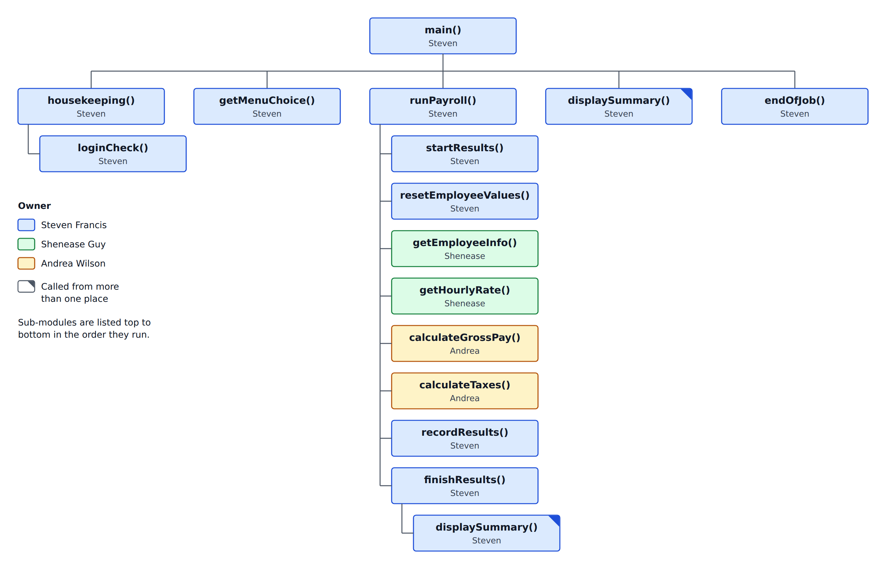

# Payroll Program Project Plan

Draft 2 · October 17, 2026 · Prepared by Steven Francis

Crimson Harriers (Red Group 1) will build a payroll program for 10 employees in pseudocode, split into six modules with one owner each. Steven's modules and the test data are ready; the drafts of Modules 1–4, due October 11, have not arrived yet.

## 1. Team

- **Group name:** Crimson Harriers
- **Group leader:** Steven Francis. The leader is confirmed at the start of each meeting and can rotate if the team agrees.
- **Tool:** pseudocode, written in the style of our textbook, *Programming Logic and Design*.

| Member | Assigned | Delivered so far (as of Oct 17) | Participation |
| --- | --- | --- | --- |
| Steven Francis | Group leader and testing lead. System design, Module 0 (main program), Module 5 (record results) | Kickoff plan (Sept 26), GitHub repository (Oct 3), system design, hierarchy chart, Draft 1 of Modules 0 and 5, Module 3 check-in (Oct 4), test data, expected results and test log (Oct 17) | Active |
| Shenease Guy | Module 1 (employee information), Module 2 (rate lookup) | Accepted her modules (Sept 29). Agreed to the GitHub workflow and said she would start (Oct 4). No draft yet | Replied in the group discussion |
| Andrea Wilson | Module 3 (gross pay), Module 4 (taxes and net pay) | No draft yet | No reply to any group post |

## 2. Scope and success

We are building a payroll "program" in pseudocode. It takes each employee's information, looks up the pay rate, calculates gross pay, taxes and net pay, and records the results in a spreadsheet. No real code is written.

**Must have**

- Entry of first name, last name, ID, number of dependents and hours worked
- Hourly rate looked up from a database, with the employee ID as the primary key
- Gross pay: hourly rate × hours up to 40, plus overtime at 1.5× for hours over 40
- State tax at 5.6% and federal tax at 7.9%, both on the pre-tax amount
- Pre-tax and post-tax amounts
- Results recorded in a spreadsheet
- All variables defined, at least 3 modules, and every member writes some pseudocode
- Security checks, with proof they were applied
- At least 10 test cases, with results

**Nice to have**

- An access code before the program starts
- A menu, and a payroll summary with totals

**Out of scope**

- Real code in any programming language
- Social Security, Medicare and other withholding
- Deploying the program

**We are done when**

- every requirement in the project instructions is covered by a module
- at least 10 test cases have been run and pass
- every member has written part of the pseudocode
- each check-in and the final project are submitted on time

The people involved are the three team members and our instructor, who reviews each check-in and the final project.

## 3. Module breakdown and owners

The program is split into six modules plus a system design, and each one has a single owner.

| # | Module | What it does | Owner |
| --- | --- | --- | --- |
| — | System design | Hierarchy chart, shared variable list, and what each module must use and set | Steven |
| 0 | Main program | Access code, menu, repeating the payroll steps for 10 employees, calling every other module in order | Steven |
| 1 | Employee information | Entry of name, ID, dependents and hours, with a security check on each | Shenease |
| 2 | Rate lookup | Finds the hourly rate using the employee ID as the primary key. Becomes a database lookup in Module 8 | Shenease |
| 3 | Gross pay | Regular pay for hours up to 40, overtime at 1.5× for hours over 40 | Andrea |
| 4 | Taxes and net pay | State tax at 5.6%, federal tax at 7.9%, net pay | Andrea |
| 5 | Record results | Writes each employee's row to the spreadsheet, keeps the totals, shows the summary | Steven |
| — | Testing | Test cases, test log, full run of 10 employees | Steven (testing lead) |

The chart shows every module, who owns it, and the order the modules run in.

All shared variables are declared once, in the main program, and listed in the system design. That lets modules written separately use the same names. Modules 3 and 4 use the values set by Modules 1 and 2, and Module 5 uses the values from all of them.

**Ownership changes:** none yet. Modules 3 and 4 have no draft and Andrea Wilson has not replied, so whether to reassign them is the team's next decision.

## 4. Schedule

Every step has an owner and a target date. Dates after October 4 are proposed and can be moved by the team.

| Step | Owner | Target date | Status |
| --- | --- | --- | --- |
| Kickoff post with the proposed plan | Steven | Sept 26 | Done |
| System design: hierarchy chart and shared variable list | Steven | Oct 3 | Done |
| Module 0 and Module 5, Draft 1 | Steven | Oct 3 | Done |
| First team meeting (none held as of Oct 4; decisions made in the group discussion) | Team | Oct 3 | Not started |
| Module 3 check-in submitted (Steven: Oct 4) | Each member | Oct 4 | Done |
| Module 1 and Module 2, Draft 1 (overdue) | Shenease | Oct 11 | Not started |
| Module 3 and Module 4, Draft 1 (overdue) | Andrea | Oct 11 | Not started |
| Ten made-up test employees, expected results and the test log | Steven (testing lead) | Oct 18 | Done |
| Unit tests: each module tested by another member | Team | Oct 25 | Not started |
| Fixes from testing, Draft 2 of every module | Each owner | Nov 1 | Not started |
| Integration test: full run of 10 employees | Steven (testing lead) | Nov 8 | Not started |
| Database lookup added to Module 2 | Shenease | During Module 8 | Not started |
| Final project assembled and submitted | Steven | End of semester (date in IvyLearn) | Not started |

## 5. Security

Security checks stop bad data at three points: when it is entered, before it is calculated, and before it is saved.

| Check | Module | Owner |
| --- | --- | --- |
| Access code with 3 tries. After the third wrong code the program ends | 0 | Steven |
| Menu choice must be 1, 2 or 3. Anything else is rejected and asked again | 0 | Steven |
| Every employee value is cleared before the next employee, so nothing carries over | 0 | Steven |
| Skipped employees are never sent to the pay calculations | 0 | Steven |
| Name is not blank, ID is in the right format, dependents is a whole number, hours is a number and not negative | 1 | Shenease |
| Unusual hours (above 60) must be confirmed by the clerk and are flagged for review | 1 | Shenease |
| Employee ID must exist in the rate table | 2 | Shenease |
| Pay amounts must make sense before saving: rate above 0, gross and net not negative, net not more than gross | 5 | Steven |

The checks in Modules 0 and 5 are written in Draft 1. The checks in Modules 1 and 2 are planned. Our instructor confirmed that confirming and flagging unusual hours is fine as long as we explain it (Oct 11).

Every employee is given a status of OK, FLAGGED, SKIPPED or ERROR. The status is saved in the spreadsheet with the employee's row, which is our proof of what each check did.

## 6. Testing

Each module is tested by someone other than its author, and the testing lead runs the whole program with 10 made-up employees.

- **Testing lead:** Steven Francis
- **Unit tests:** every module file has a table of test scenarios with the expected result. The tester fills in the actual result and marks pass or fail. Modules 0 and 5 have 22 scenarios written so far. Shenease tests Steven's modules and Steven tests hers; the tester for Modules 3 and 4 is still open.
- **Integration test:** one full run of 10 employees, checked against expected results calculated in advance (`data/payroll-results-sample.csv`).
- **Evidence:** the completed test log (`tests/test-log.md`) and the results spreadsheet, checked against the expected results in `data/payroll-results-sample.csv`.

Planned test cases for the full run:

| # | Scenario | Rate | Hours | Expected result |
| --- | --- | --- | --- | --- |
| 1 | Standard week | $18.00 | 40 | Gross $720.00, state $40.32, federal $56.88, net $622.80 |
| 2 | Part-time | $21.00 | 32 | Gross $672.00, state $37.63, federal $53.09, net $581.28 |
| 3 | Overtime | $20.00 | 45 | Gross $950.00, state $53.20, federal $75.05, net $821.75 |
| 4 | Just past 40 hours | $25.00 | 40.5 | Gross $1,018.75, state $57.05, federal $80.48, net $881.22 |
| 5 | Heavy overtime | $16.00 | 60 | Gross $1,120.00, state $62.72, federal $88.48, net $968.80 |
| 6 | Zero hours | $30.00 | 0 | Accepted. All amounts $0.00 |
| 7 | Unusual hours | $22.00 | 80 | Clerk must confirm. Flagged. Gross $2,200.00, state $123.20, federal $173.80, net $1,903.00 |
| 8 | Negative hours | $19.50 | −5, then 38 | −5 rejected and asked again. Then gross $741.00, state $41.50, federal $58.54, net $640.96 |
| 9 | ID not in the rate table | not on file | 40 | Employee skipped. Row saved as SKIPPED |
| 10 | Letters in the hours field | $17.25 | "forty", then 40 | "forty" rejected and asked again. Then gross $690.00, state $38.64, federal $54.51, net $596.85 |

## 7. Communication and collaboration

We talk in the IvyLearn group and keep the pseudocode in a public GitHub repository.

- **IvyLearn group (Crimson Harriers):** the "Let's Get Started" discussion and an Inbox thread. Decisions and meeting notes are posted there so our instructor can see them.
- **GitHub:** one file per module, edited in the browser. The history shows who wrote what and when.
- **Members who prefer not to use GitHub** send their pseudocode in the Inbox thread, and the leader adds it with their name.
- **Meetings:** attendance and decisions are recorded in the meeting log below.
- **Changes to the plan:** reviewed at each check-in. Changes to shared variable names go through the leader, so the design page and the main program stay in step.

## 8. Meeting log

No team meeting has been held yet. Decisions so far were made in the IvyLearn discussion "Let's Get Started", where Steven posted the plan (Sept 26) and Shenease replied (Sept 29 and Oct 4). Andrea has not replied. The full log is in `check-ins/meeting-log.md`.

## 9. Open questions

- [x] Group name: Crimson Harriers
- [x] Testing lead: Steven Francis
- [x] Should dependents affect tax? No, they are only recorded (instructor, Oct 11)
- [x] Reject unusual hours, or confirm and flag? Either is fine if explained; we confirm and flag (instructor, Oct 11)
- [ ] Reassign Modules 3 and 4 if Andrea Wilson stays unresponsive? (team)
- [ ] Employee ID format. The suggestion is 4 digits, such as 1001 (Shenease)
- [ ] Is 60 the right limit for unusual hours, and should zero hours be flagged? (Shenease)
